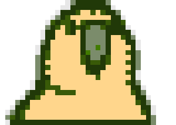

<!-- ============================== HEADER ============================== -->

<!-- LANG-SWITCHER -->

  
  
  
  

<!-- /LANG-SWITCHER -->

  

  
  
  
  

<!-- ============================== ABOUT ============================== -->
<h2 align="center">
  
  Über Mich
</h2>

<table>
  <tr>
    <td width="78%">
      Ich bin <b>Luis Gabriel Goés de Santana</b>, <b>Full-Stack-Entwickler</b> aus Salvador, Brasilien 🇧🇷, und begeistere mich für
      Technologie, Softwareentwicklung und künstliche Intelligenz. Ich habe einen Abschluss in <b>Software Engineering</b> von der
      <b>Universidade Católica do Salvador</b> und lerne ständig weiter, um mein Wissen zu erweitern.
        
      🏗️ Ich entwickle skalierbare, effiziente Anwendungen nach <b>Clean Code</b> und <b>Clean Architecture</b> 
      ☕ Im Alltag: <b>Java / Spring Boot</b> im Backend und <b>Angular / TypeScript</b> im Frontend 
      🦀 Nebenprojekte: schlanke, native Desktop-Apps in <b>Rust</b> 
      🤖 <b>KI</b> in echten Produkten: RAG, LangChain4j und Spring AI 
      🌐 Komplettes Portfolio auf <a href="https://luisgoes.com.br"><b>luisgoes.com.br</b></a>
    </td>
    <td width="22%" align="center">
      
    </td>
  </tr>
</table>

<!-- ============================== PROJECTS ============================== -->
<h2 align="center">
  
  Ausgewählte Projekte
</h2>

<!--
  To add a project: copy the <table> block below (from <table> to </table>),
  paste it right under this one and swap the icon, name, links, image, description and badges.
-->

<table>
  <tr>
    <td align="center">
       
      
      <h3>
        <a href="https://github.com/Lu1sGabriel/taskbeat">Taskbeat</a>
      </h3>
      

        <i>Die Musik, die gerade läuft, immer griffbereit — in der Windows-Taskleiste und in der Mac-Notch.</i>
      

      

        
        
        
        
        
        
      

      
      

        Ein kleines Widget mit Cover, Titel und Steuerung. Ein Klick öffnet eine Karte mit Fortschritt, Lautstärke,
        Mixer pro App und dem nächsten Titel. Funktioniert mit Spotify, YouTube Music, Apple Music, Deezer, TIDAL, VLC und dem Browser.
      

      <table>
        <tr>
          <td align="center" width="25%">⚡ <b>~0% CPU</b> im Leerlauf</td>
          <td align="center" width="25%">📦 <b>~2.5 MB</b> kleiner Installer</td>
          <td align="center" width="25%">🦀 <b>Natives Rust</b> ohne Runtime</td>
          <td align="center" width="25%">🌍 <b>4 Sprachen</b> EN · PT · ES · DE</td>
        </tr>
      </table>
      

        
        
      

    </td>
  </tr>
</table>

<!-- ============================== TECH STACK ============================== -->
<h2 align="center">
  
  Technologien
</h2>

  

<!-- ============================== STATS ============================== -->
<h2 align="center">
  
  GitHub-Statistiken
</h2>

<!-- Both cards in the first row have the same 495:195 aspect ratio, so they line up at any width. -->

  
  

  

  

<!-- Snake animation, regenerated daily by .github/workflows/snake.yml -->

  <picture>
    <source media="(prefers-color-scheme: dark)" srcset="https://raw.githubusercontent.com/Lu1sGabriel/Lu1sGabriel/output/github-snake-dark.svg" />
    <source media="(prefers-color-scheme: light)" srcset="https://raw.githubusercontent.com/Lu1sGabriel/Lu1sGabriel/output/github-snake.svg" />
    
  </picture>

<!-- ============================== CONTACT ============================== -->
<h2 align="center">
  
  Kontakt
</h2>

  

  Lust, über ein Projekt, eine Stelle oder einfach Ideen zu sprechen? Schreib mir:

  
  
  

