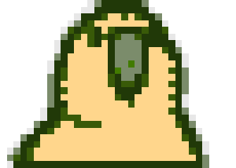

<!-- ============================== HEADER ============================== -->

<!-- LANG-SWITCHER -->

  
  
  
  

<!-- /LANG-SWITCHER -->

  

  
  
  
  

<!-- ============================== ABOUT ============================== -->
<h2 align="center">
  
  Sobre Mí
</h2>

<table>
  <tr>
    <td width="78%">
      Soy <b>Luis Gabriel Goés de Santana</b>, <b>Desarrollador Full Stack</b> de Salvador, Brasil 🇧🇷, apasionado por la
      tecnología, el desarrollo de software y la inteligencia artificial. Soy graduado en <b>Ingeniería de Software</b> por la
      <b>Universidade Católica do Salvador</b> y sigo estudiando para ampliar mis conocimientos.
        
      🏗️ Construyo aplicaciones escalables y eficientes, guiado por <b>Clean Code</b> y <b>Clean Architecture</b> 
      ☕ En el día a día: <b>Java / Spring Boot</b> en el back-end y <b>Angular / TypeScript</b> en el front-end 
      🦀 Proyectos personales: apps de escritorio ligeras y nativas en <b>Rust</b> 
      🤖 Explorando la <b>IA</b> en productos reales: RAG, LangChain4j y Spring AI 
      🌐 Portafolio completo en <a href="https://luisgoes.com.br"><b>luisgoes.com.br</b></a>
    </td>
    <td width="22%" align="center">
      
    </td>
  </tr>
</table>

<!-- ============================== PROJECTS ============================== -->
<h2 align="center">
  
  Proyectos Destacados
</h2>

<!--
  To add a project: copy the <table> block below (from <table> to </table>),
  paste it right under this one and swap the icon, name, links, image, description and badges.
-->

<table>
  <tr>
    <td align="center">
       
      
      <h3>
        <a href="https://github.com/Lu1sGabriel/taskbeat">Taskbeat</a>
      </h3>
      

        <i>La música que está sonando, siempre a mano — en la barra de tareas de Windows y en el notch del Mac.</i>
      

      

        
        
        
        
        
        
      

      
      

        Un widget discreto con portada, título y controles. Un clic abre la tarjeta con progreso, volumen,
        mezclador por app y la siguiente canción. Funciona con Spotify, YouTube Music, Apple Music, Deezer, TIDAL, VLC y el navegador.
      

      <table>
        <tr>
          <td align="center" width="25%">⚡ <b>~0% CPU</b> en reposo</td>
          <td align="center" width="25%">📦 <b>~2.5 MB</b> instalador ligero</td>
          <td align="center" width="25%">🦀 <b>Rust nativo</b> sin runtime</td>
          <td align="center" width="25%">🌍 <b>4 idiomas</b> EN · PT · ES · DE</td>
        </tr>
      </table>
      

        
        
      

    </td>
  </tr>
</table>

<!-- ============================== TECH STACK ============================== -->
<h2 align="center">
  
  Tecnologías
</h2>

  

<!-- ============================== STATS ============================== -->
<h2 align="center">
  
  Estadísticas de GitHub
</h2>

<!-- Both cards in the first row have the same 495:195 aspect ratio, so they line up at any width. -->

  
  

  

  

<!-- Snake animation, regenerated daily by .github/workflows/snake.yml -->

  <picture>
    <source media="(prefers-color-scheme: dark)" srcset="https://raw.githubusercontent.com/Lu1sGabriel/Lu1sGabriel/output/github-snake-dark.svg" />
    <source media="(prefers-color-scheme: light)" srcset="https://raw.githubusercontent.com/Lu1sGabriel/Lu1sGabriel/output/github-snake.svg" />
    
  </picture>

<!-- ============================== CONTACT ============================== -->
<h2 align="center">
  
  Hablemos
</h2>

  

  ¿Quieres hablar de un proyecto, una oportunidad laboral o simplemente intercambiar ideas? Escríbeme:

  
  
  

