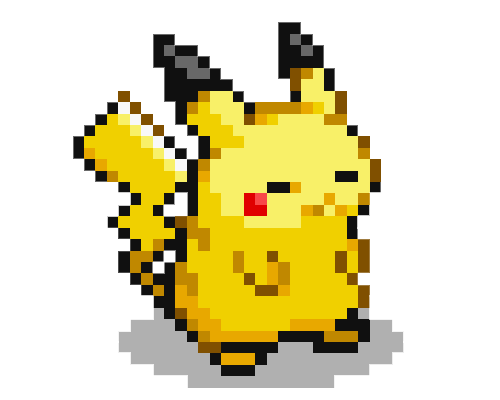
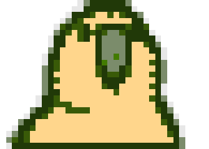
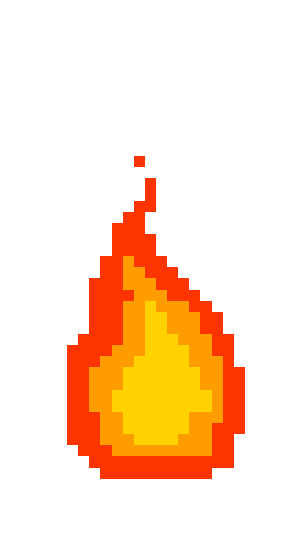
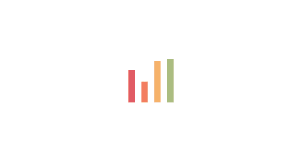
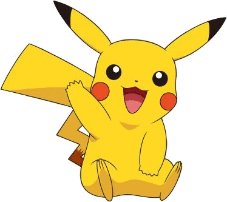

<!-- Animated header -->

  

  

  
  
  
  

<h2>
  
  About Me
</h2>

I'm **Luis Gabriel Goés de Santana**, a **Full Stack Developer** from Salvador, Brazil 🇧🇷, passionate about technology, software development and artificial intelligence. I'm studying **Software Engineering** at **Universidade Católica do Salvador**.

- 🏗️ I build scalable, efficient applications guided by **Clean Code** and **Clean Architecture**
- ☕ Day to day: **Java / Spring Boot** on the back end and **Angular / TypeScript** on the front end
- 🦀 Side quests: lightweight, native desktop apps in **Rust**
- 🤖 Exploring **AI** in real products: RAG, LangChain4j and Spring AI
- 🌐 Full portfolio at **[luisgoes.com.br](https://luisgoes.com.br)**

<h2>
  
  Featured Projects
</h2>

<!--
  To add a project: copy the <table> block below (from <table> to </table>),
  paste it right under this one and swap the name, links, image, description and badges.
-->

<table>
  <tr>
    <td>
      <h3>
        
        <a href="https://github.com/Lu1sGabriel/taskbeat">Taskbeat</a>
      </h3>
      

        <b>Your now-playing music, always at hand:</b> a tiny widget on the Windows taskbar and in the Mac notch,
        with cover art, title and controls. One click opens a card with progress, volume, a per-app mixer and what's up next.
        Works with Spotify, YouTube Music, Apple Music, Deezer, TIDAL, VLC and your browser.
      

      

        
      

      <ul>
        <li>⚡ Written in <b>Rust</b> with no runtime and no embedded browser: <b>~0% CPU</b> when idle.</li>
        <li>📦 A <b>~2.5 MB</b> installer, no admin rights needed.</li>
        <li>🔌 Native integrations: <b>SMTC</b>, <b>WASAPI</b> and <b>DirectWrite</b> on Windows; <b>MediaRemote</b>, <b>Core Audio</b> and <b>AppKit</b> on macOS.</li>
        <li>🌍 Available in English, Portuguese, Spanish and German.</li>
      </ul>
      

        
        
        
        
        
        
      

      

        <a href="https://github.com/Lu1sGabriel/taskbeat/releases/latest"><b>⬇ Download</b></a>
        &nbsp;·&nbsp;
        <a href="https://github.com/Lu1sGabriel/taskbeat"><b>View repository</b></a>
      

    </td>
  </tr>
</table>

<h2>
  
  Tech Stack
</h2>

<table>
  <tr>
    <td><b>Back end</b></td>
    <td></td>
  </tr>
  <tr>
    <td><b>Front end</b></td>
    <td></td>
  </tr>
  <tr>
    <td><b>Desktop</b></td>
    <td></td>
  </tr>
  <tr>
    <td><b>Databases</b></td>
    <td></td>
  </tr>
  <tr>
    <td><b>Tools &amp; DevOps</b></td>
    <td></td>
  </tr>
</table>

<h2>
  
  GitHub Stats
</h2>

  
  

  

  

<!-- Snake animation, regenerated daily by .github/workflows/snake.yml -->

  <picture>
    <source media="(prefers-color-scheme: dark)" srcset="https://raw.githubusercontent.com/Lu1sGabriel/Lu1sGabriel/output/github-snake-dark.svg" />
    <source media="(prefers-color-scheme: light)" srcset="https://raw.githubusercontent.com/Lu1sGabriel/Lu1sGabriel/output/github-snake.svg" />
    
  </picture>

<h2>
  
  Let's Connect
</h2>

Want to talk about a project, a job opportunity or just swap ideas? Reach out:

  
  
  

<!-- Animated footer -->

